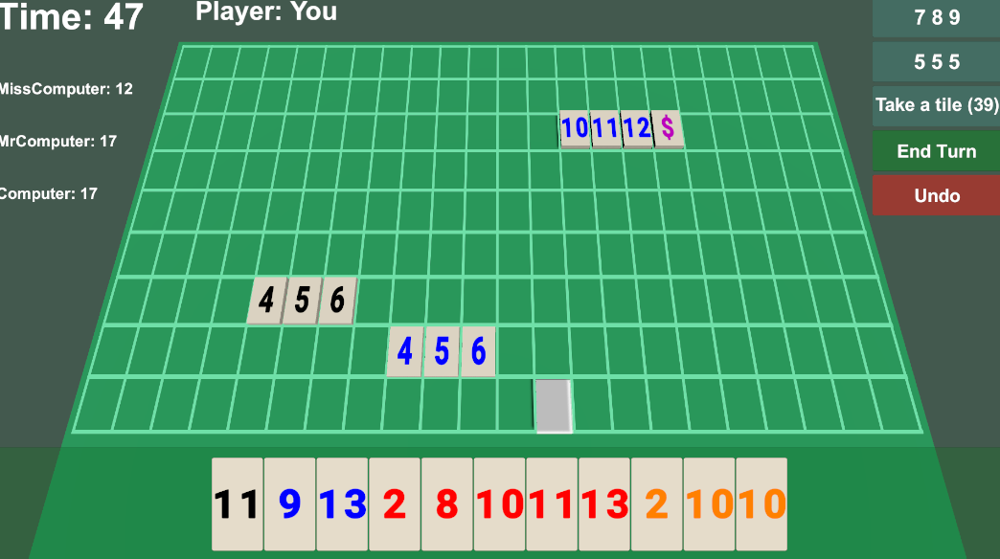

# Rummikub with AI: Reinforcement Learning for a Board Game Player

A 2.5D implementation of the board game **Rummikub** in Unity, with a rule-based computer player and **reinforcement learning agents** trained using the Unity ML-Agents Toolkit.

The project was developed across two theses at the Silesian University of Technology:

| Thesis | Title | Scope |
|---|---|---|
| BEng (Computer Science, 2025) | *2.5D board game with machine learning for computer players* | Game environment, rule-based player, ML-Agents integration |
| MSc (Data Science, 2026) | *Applying AI Algorithms to Train a Computer Player in a Logic Board Game* | Curriculum Learning environment, PPO vs. PPO+GAIL experiments |



## Highlights

- Full Rummikub game in Unity (C#): board, player rack, turn management, timer, rule validation, undo.
- Rule-based computer player that analyses the board and performs valid moves.
- RL agent with a **multi-branch discrete action space** (about 240 board positions × 6 functions × 64 tiles × 240 source positions) and **action masking** of illegal moves.
- **Curriculum Learning** environment with 12 levels of increasing difficulty to tackle the sparse reward problem.
- **Imitation learning (GAIL)** using demonstrations recorded from the rule-based player.
- Controlled experiment: **20 independently trained agents** (10 per method), each evaluated over **1,000 episodes**.

## Tech stack

| Area | Tools |
|---|---|
| Game engine | Unity 2022.3.48f1, C# |
| Reinforcement learning | Unity ML-Agents 0.30.0, PPO, GAIL |
| Training backend | Python 3.9, PyTorch 2.8.0 (CUDA 12.8) |
| Analysis | Python (pandas), TensorBoard |
| Documentation | LaTeX |

## Game modes

| Scene | Players |
|---|---|
| `Menu` | Main menu |
| `Player_CP_Game` | Human vs. rule-based computer players |
| `Player_AI_Game` | Human vs. trained AI agent |
| `Player_AI_CP_Game` | Human vs. AI agent and rule-based player |
| `CP_AI_Game` | Rule-based player vs. AI agent (no human) |

## Reinforcement learning design

### Observations
The game state is converted into a numerical vector: tiles on the board and in the agent's rack, with one-hot encoded colours, values normalised to [0, 1] and their positions.

### Actions and masking
The agent chooses actions across four discrete branches:

| Branch | Range | Meaning |
|---|---|---|
| Target position | 0–239 | Where a tile is placed or moved to |
| Function | 0–5 | Place, move, remove, draw, undo, end turn |
| Tile index | 0–63 | Which tile from the rack is used |
| Source position | 0–239 | Where a tile is moved or removed from |

Board coordinates are flattened with **matrix index mapping** (`index = z * xSize + x`), so each board position is a single action value. This makes it possible to mask illegal positions, because ML-Agents masks values only within a single branch.

### Rewards
Besides the final reward or penalty for an episode, the agent receives **shaped rewards** for partial progress, for example for correctly placing the first tile of a set. This separates completely wrong behaviour from partially correct attempts.

### Curriculum
12 levels, grouped into three stages:

| Stage | Levels | Task |
|---|---|---|
| Basic run placement | 0–2 | Complete a run (consecutive numbers, one colour), from 1 missing tile to an empty board |
| Basic group placement | 3–5 | Complete a group (same number, different colours) |
| Mixed combinations | 6–11 | Random runs or groups of 3–4 tiles, several sets on the board at once |

The trainer moves the agent to the next level once the mean reward passes a promotion threshold of 0.7. The same agent class and network outputs are used at every level; actions not needed yet are blocked with masks.

## Results (MSc thesis)

Two configurations were compared, each with 10 independently trained agents. Win rate is measured over 1,000 evaluation episodes per agent on the final curriculum level.

| Metric | PPO baseline | PPO + GAIL |
|---|---|---|
| Agents that completed the curriculum | 9 / 10 | **10 / 10** |
| Mean win rate | 65.1% | **70.0%** |
| Win rate range | 35.4–72.1% | 62.4–73.9% |
| Mean environment steps | 1.35M | 1.38M |
| Mean active training time | **6.0 h** | 10.7 h |

**Findings**
- Curriculum learning combined with reward shaping and action masking allowed agents to master selected tile-placement mechanics of a complex game with sparse rewards.
- GAIL did not reduce the number of training steps and took longer in wall-clock time, but it made training **more reliable**: all GAIL agents finished the curriculum, and their results varied much less between runs.

**Limitations.** The trained policies solve tile-placement tasks in a simplified single-agent setting (no opponents, turn timer or long-term strategy). They are not yet a complete Rummikub player.

**Possible next steps:** extend the curriculum towards the full game, record level-specific demonstrations for GAIL, tune hyperparameters, and test other methods (SAC, curiosity, RND).

## Repository structure

```
RummiAI/                      Unity project
├── Assets/scripts/           Game logic, computer player, RL agent, curriculum trainer
├── Assets/Scenes/            Game modes
├── Assets/Scenes/nauka/      Training and demonstration-recording scenes
└── Assets/models/            Trained models (.onnx)
configs/                      ML-Agents training configurations (PPO baseline, PPO+GAIL)
Raport/                       BEng thesis (LaTeX, in Polish)
master-thesis/                MSc thesis (LaTeX, in English) with result data (CSV)
```

## How to run

### Play the game
1. Install **Unity 2022.3.48f1** through Unity Hub.
2. Open the `RummiAI` folder as a project. Unity regenerates the `Library` folder on first launch, which can take a few minutes.
3. Open `Assets/Scenes/Menu.unity` and press **Play**.

### Train an agent
1. Create a Python 3.9 virtual environment and install ML-Agents:
   ```bash
   python -m venv venv_3_9
   venv_3_9\Scripts\activate          # Linux/macOS: source venv_3_9/bin/activate
   pip install mlagents==0.30.0
   ```
2. Start the trainer with a configuration file:
   ```bash
   mlagents-learn configs/ppo_baseline.yaml --run-id=<run_name>
   ```
3. When the trainer waits for a connection, open a training scene from `Assets/Scenes/nauka/` and press **Play** in Unity.
4. Monitor progress with `tensorboard --logdir results`.

For faster training, the experiments ran five game instances in parallel from a built executable, with rendering disabled:
```bash
mlagents-learn <config>.yaml --run-id=<run_name> --env=<path_to_build>/game.exe --num-envs=5 --no-graphics
```

Each run directory contains TensorBoard event files (including custom statistics such as the current curriculum level), checkpoints and the exported ONNX model.

### Evaluate an agent
Assign the exported `.onnx` model to the agent's **Behavior Parameters** in the evaluation scene. The `EvaluationManager` object sets the agent index, the number of episodes (1,000 in the thesis), the curriculum level and the output file; wins and losses are saved to a CSV file.

### Training configurations
The configurations used in the MSc experiments are in [`configs/`](configs/):

| Setting | [`ppo_baseline.yaml`](configs/ppo_baseline.yaml) | [`ppo_gail.yaml`](configs/ppo_gail.yaml) |
|---|---|---|
| Trainer | PPO | PPO |
| Network | 2 layers × 128 units, LSTM memory (128, sequence 32) | same |
| Learning rate / batch / buffer | 3e-4 (linear) / 512 / 8,192 | same |
| Extrinsic reward | strength 1.0, γ = 0.995 | same |
| GAIL reward | – | strength 0.4, γ = 0.99, uses actions |
| Max steps | 2,000,000 | 2,000,000 |
| Curriculum promotion | mean reward ≥ 0.7, min. 500 episodes per lesson | same |

Both files define lessons beyond level 11 for future extension of the curriculum; in the experiments, training was stopped once an agent completed level 11 (reached level 12) or hit the step limit.

GAIL requires the expert demonstration file `RummikubExpert.demo`, recorded from the rule-based player in the `Recording_CP` scene. The path is set in `demo_path` in `ppo_gail.yaml`.

## Author

**Jagoda Wiecek**: [LinkedIn](https://www.linkedin.com/in/jagodawięcek/)